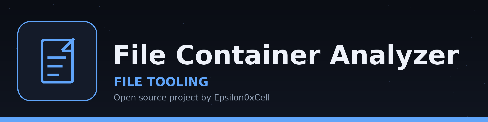

# file-container-analyzer
Identifies and extracts embedded files within container formats like ZIP, JAR, or OLE, providing details about each extracted file (size, type, name). - Focused on File operations and analysis

## Install
`git clone https://github.com/ShadowGuardAI/file-container-analyzer`
Then install the OLE dependency: `pip install -r requirements.txt`, which installs olefile. The ZIP and JAR path uses only the standard library and runs without olefile installed; olefile is imported only when an OLE container is analyzed, and it is required for that work.

Extraction keeps each entry under its own folder path inside the output directory, so entries with the same file name in different folders both survive. Entry paths are sanitized to stay inside the output directory. Before extracting, every entry target is resolved: if any target resolves to the container file itself, the run is refused at exit 1 before anything is written and the container is left unchanged. A missing or unsupported container exits 1, and an empty container (a valid archive with no entries) exits 1 with a plain line and is never a completed analysis.

## Usage
`./file-container-analyzer [params]`

## Parameters
- `-h`: Show help message and exit
- `-o`: No description provided
- `-l`: List embedded files without extracting.
- `-v`: No description provided

## License
Copyright (c) ShadowGuardAI
